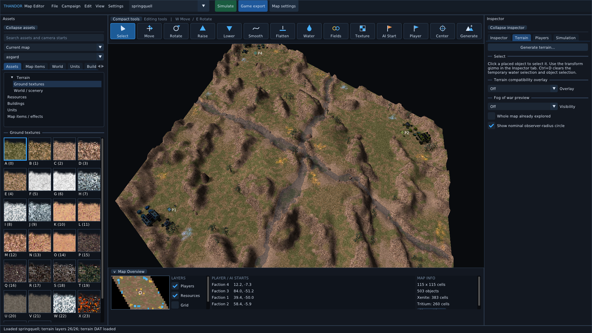
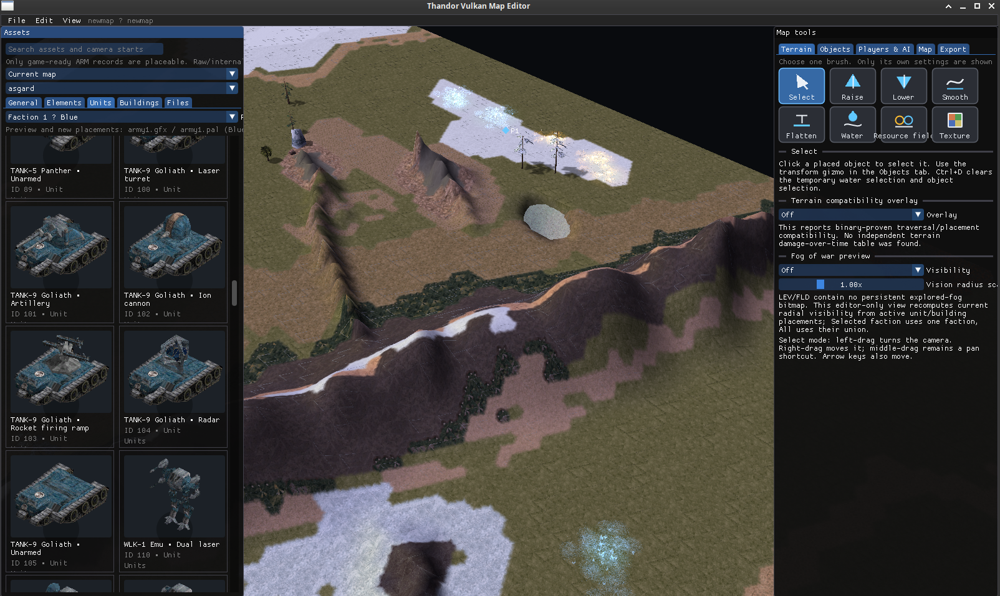
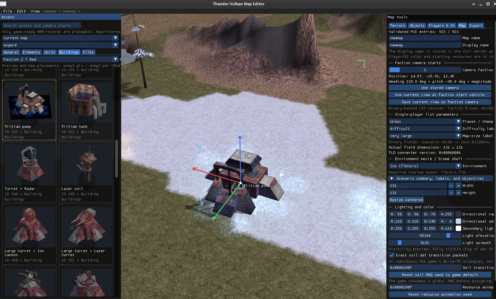
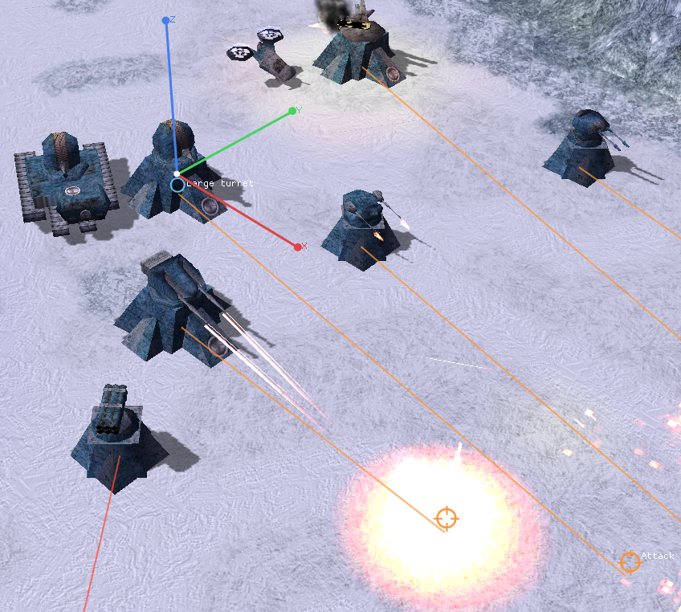
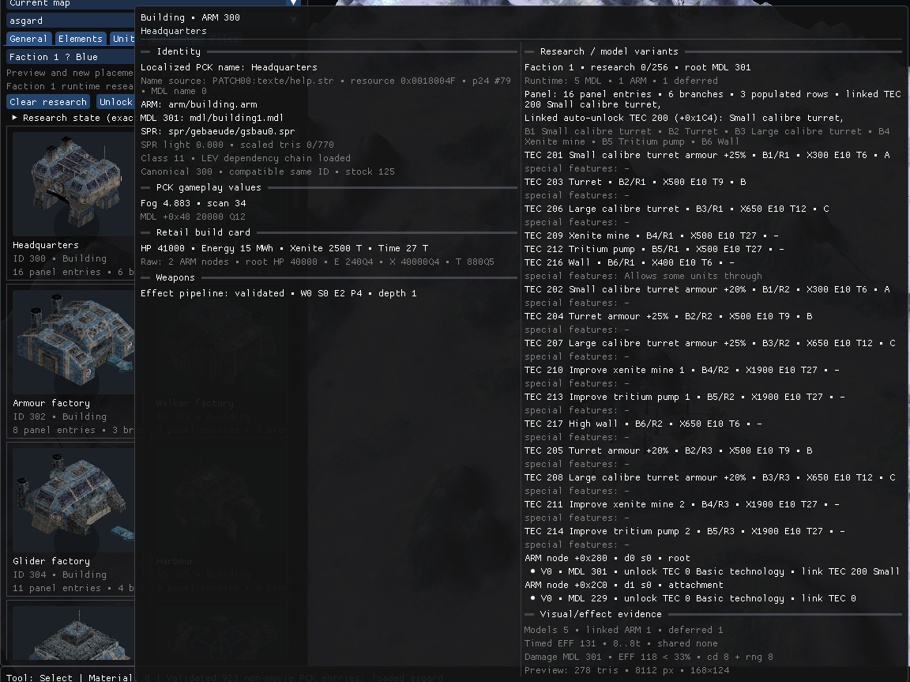
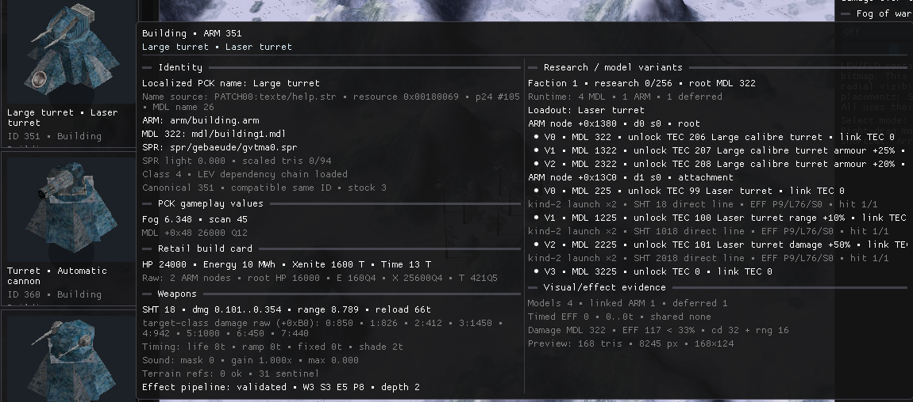
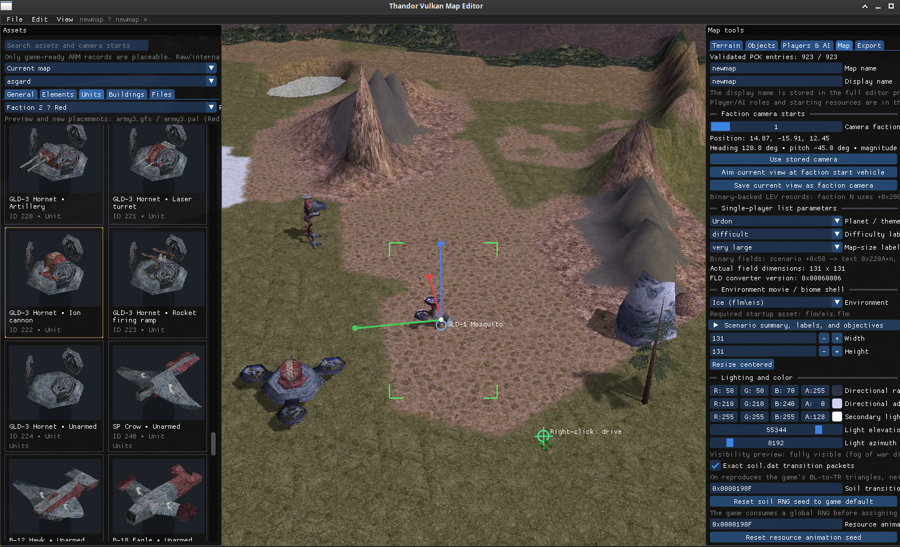
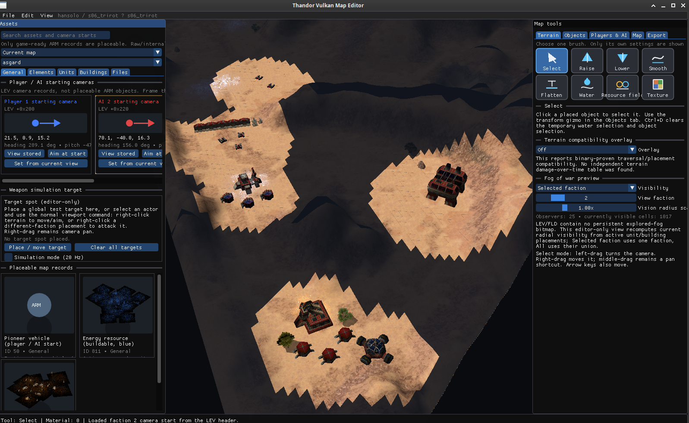
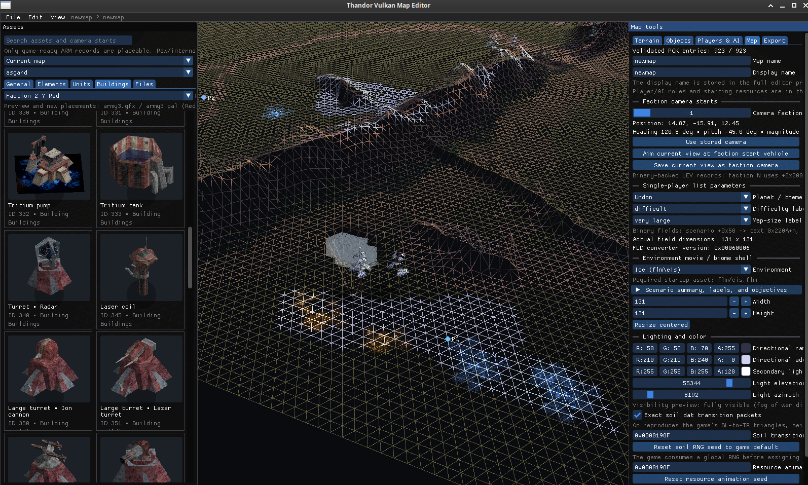

The editor uses vulkan. Will update the readme when I have more time.

There are known issues:
- unit animations still not perfect
- Simulation stuff is not implemented fully. Goal is to simulate ki.dat actions to optimize weights there.
- Building rotation not implemented correctly yet
- Simulating attack points on the lower area of the screen or driving units there sets the pointer out of view

if you want to report bugs, join discord https://thandor.cc/ and post in https://discord.com/channels/263613631348867072/1534527583503257692

# Screenshots

## Main View

## Stock Maps

## Custom Maps

## Buildings and Units

## Effects and Attacks

## Moving Units

## Fog of war

## Wireframe View

