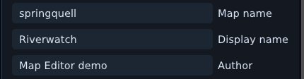
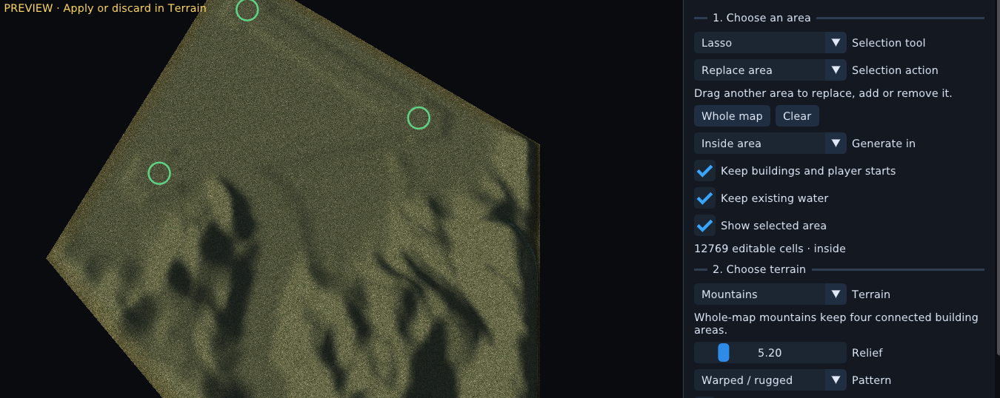
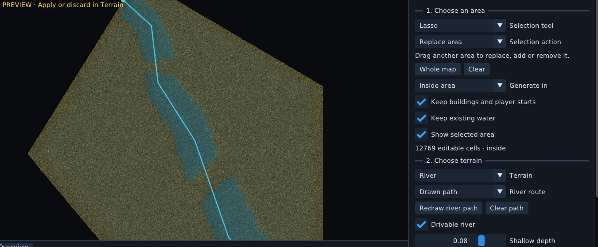
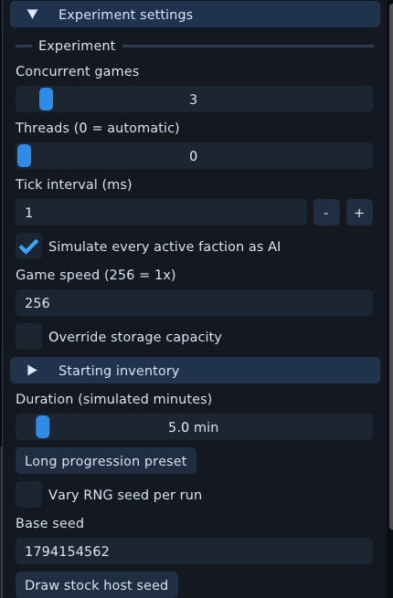
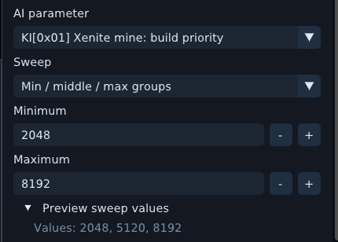
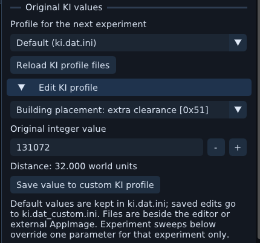
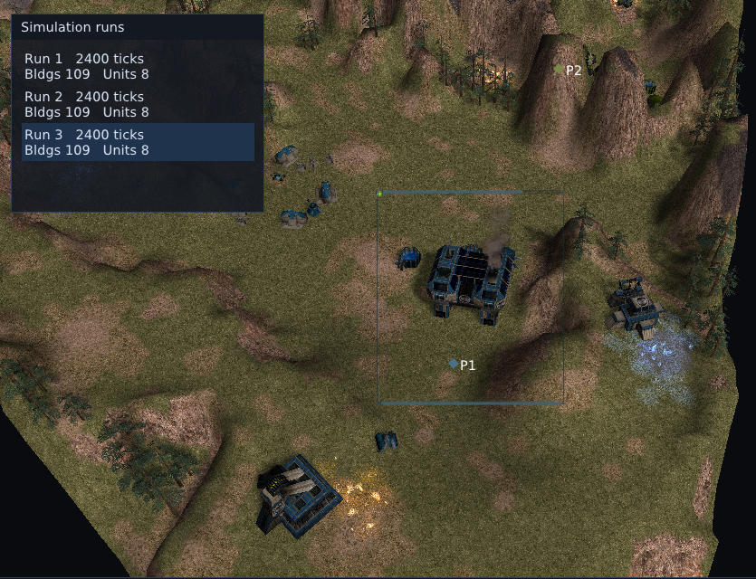
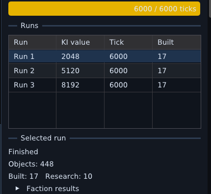
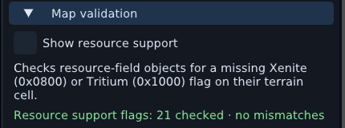
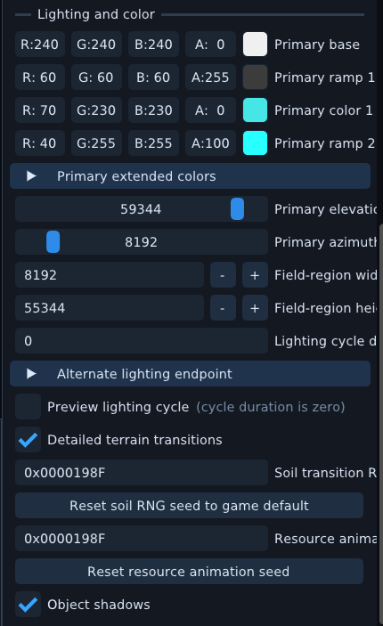

# Thandor Map Editor

Update:
Released AppImage and new Windows version, see releases!

A Vulkan map editor for Thandor, with stock and custom maps, an asset browser, terrain tools, unit and building inspection, and Simulation Lab experiments for KI.DAT-driven AI.

**Ingame AI validation:** Recorded testing against native open-thandor passed **all 55 maps, four seeds per map, through tick 75,000**—**62.5 simulated minutes per run**. The matrix covers **220 cases** and checks 12 audited state channels at every tick.

These screenshots show **0.9.781**, captured again on November 9, 2026. Most are cropped to the feature being described; the first image shows the complete editor.

## Editor overview

Open stock maps directly from the map selector, browse assets, edit terrain and placed objects, and navigate with the map overview. This example shows Springquell.

## Custom maps and map identity

Browse saved `.thmap` projects and loose `.lev` maps. The editor scans `maps/` beside the executable or AppImage, including subfolders, as well as the game’s map folders. Use **Refresh file list** for files added while the editor is open. Loose `.lev` maps need their referenced terrain and assets.

This capture focuses on the load dialog. Riverwatch and Volcanic crossing are demonstration projects based on Springquell and Lavam.

In **Map settings**, set the internal map name, display name and author. The project keeps the display name and author for the native game's Custom maps browser.

In **Players**, choose the active factions and **Human player slot**, which sets the default faction offered to the player. Custom games assign the other active factions to AI; the player can change the selected faction before starting.

## Terrain generation

Generate hills, mountains, lakes, rivers, depressions, plateaus and plains on new or loaded maps. Work on the whole map or select an area with a lasso or rectangle. Options protect buildings, player starts and existing water.

### Mountain preview and settings

Choose a terrain type and pattern, then adjust relief, feature size, border blending and the seed. The preview below shows generated mountains and reserved building areas alongside the controls that produced them.

Apply the preview to keep it, reroll for another result, or discard it. Applied terrain generation can be undone with **Ctrl+Z**.

### Drawn river routes

Use a direction or draw a river route. Tune channel width, depth and crossings. **Drivable river** checks ground traversal before applying; this example uses a drawn route and shallow water.

## Simulation Lab

Run independent simulations on the same map, experiment with original KI.DAT parameter values, and inspect the selected run in the 3D viewport. These examples use Lucas03.

### Experiment setup and parameter sweeps

Set concurrent games, thread limit, tick interval, simulated duration and seed. Keep the same seed across runs to compare parameter variants. **Draw stock host seed** draws a session seed using the stock host's RNG step.

The sweep shown here varies **Xenite mine: build priority** across 2,048, 5,120 and 8,192. The preview lists the exact values before the experiment starts.

| Experiment settings | Parameter sweep and value preview |
| --- | --- |
|  |  |

### Original KI profiles

The editor creates `ki.dat.ini` on first startup. Saving an edited value creates `ki.dat_custom.ini`; choose the default or custom profile for the next experiment. Running experiments retain their starting values. Named parameters show their original integer values and decoded units where known.

### Inspect a run's world

Select a run to inspect its units, buildings and AI activity. This viewport crop shows the third parameter variant at tick 2,400, with the run selector kept in view.

### Completed results

The results below come from a completed three-run experiment at tick **6,000**, or **five simulated minutes**. The table shows each KI value, tick and build count; the selected run summary includes research results. This short UI demonstration is separate from the recorded 75,000-tick validation matrix linked above.

## Buildings and units

Browse faction assets and select placed buildings or units to inspect their identity, faction, position, orientation and gameplay properties. This close view pairs a Headquarters on `hansolo/s10_flug` with its object inspector.

## Fog of war

Inspect a faction's visibility during simulation. This viewport crop shows Lucas03 at tick 1,800, with the visible base and the surrounding fog boundary.

## Resource validation

Open **Map settings → Map validation**. The validator checks resource-field objects whose terrain cell lacks the matching Xenite or Tritium support flag. **Show resource support** displays the selected resource overlay. This Asgard capture shows 21 checked deposits with no mismatches.

## Lighting and shadows

Map settings include lighting colors and direction, a lighting-cycle preview, terrain and resource animation seeds, and object shadows. This crop focuses on those controls for Hargonatoll.

Interface scale, logging and FPS display are available from **Settings**.

## Bug reports

Join the [Thandor community](https://thandor.cc/) and post in the [Discord bug-report channel](https://discord.com/channels/263613631348867072/1534527583503257692).
